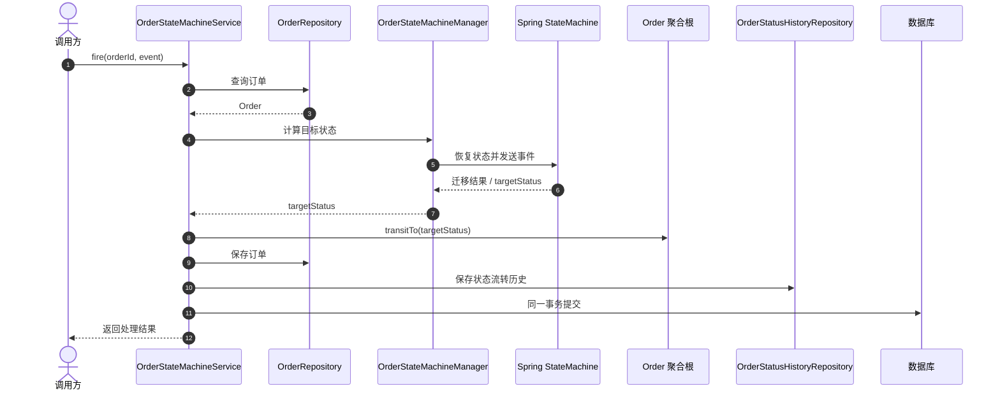

# DDD订单领域模型示例项目

## 1. 项目说明

本项目以订单为核心演示 DDD 分层设计，并使用 Spring StateMachine管理订单状态迁移。接口层接收请求，应用层编排用例，领域层维护订单模型与状态规则，基础设施层负责数据库、消息队列及外部服务集成。

## 2. 项目结构

本项目采用典型的DDD分层架构，将业务逻辑、领域模型与技术实现清晰分离。整体结构如下：

    com/hengline/ddd/
    ├── application/               # 应用层
    │   ├── dto/                   # 数据传输对象
    │   └── service/               # 应用服务
    ├── domain/                    # 领域层（核心）
    │   ├── event/                 # 领域事件
    │   ├── model/                 # 领域模型（实体、值对象、聚合）
    │   ├── repository/            # 领域仓储接口
    │   ├── service/               # 领域服务
    │   └── statemachine/          # 状态机（管理聚合状态转换）
    ├── infrastructure/            # 基础设施层
    │   ├── config/                # 配置类
    │   ├── exception/             # 异常处理
    │   ├── integration/           # 外部系统集成
    │   ├── messaging/             # 消息发布/订阅
    │   └── persistence/           # 仓储实现
    └── interfaces/                # 接口层
        ├── app/                   # 应用接口
        └── web/                   # Web接口

### 2.1 分层职责

-   **interfaces**：接收 HTTP 请求并返回响应。
-   **application**：编排订单用例、事务和状态变更流程。
-   **domain**：定义 `Order`、订单项、支付信息、状态机及仓储接口。
-   **infrastructure**：实现 JPA 持久化、消息发布和支付/库存 ACL。

### 2.2 系统架构图

下图展示接口层、应用层、领域层与基础设施层的依赖关系。业务请求由接口层进入应用层，应用服务协调订单聚合根与状态机；仓储、消息队列和外部支付/库存系统等技术细节由基础设施层实现。

**架构约束：**

-   接口层只负责协议适配、参数转换和调用应用服务，不直接操作数据库或状态机。
-   应用层负责事务边界和用例编排；领域规则由 `Order`聚合根及状态机共同表达。
-   状态机用于判断事件是否允许发生及计算目标状态；由应用服务调用聚合根方法更新状态并持久化。
-   领域层定义仓储和 ACL 抽象，基础设施层提供具体实现。
-   领域事件应在事务提交后对外发布；若要求数据库与 Kafka可靠一致，建议采用 TransactionalOutbox，而不是只依赖普通事务内发送消息。

## 3. 订单领域模型设计

### 3.1 聚合根：Order

`Order`是订单聚合根，负责维护订单状态、订单项和支付信息，并通过领域方法保护业务约束。订单状态的迁移合法性由状态机配置判断；应用服务根据状态机返回的目标状态调用聚合根方法完成变更。

### 3.2 相关实体

-   `ProductItem`：描述订单中的商品、数量和成交单价。
-   `OrderPayment`：记录订单对应的支付信息。

它们属于订单业务模型的一部分，具体关联关系以实体映射代码为准。

### 3.3 金额

金额使用 `BigDecimal` 表示，避免使用浮点数进行金额计算。若项目中的`Money`值对象已被实际业务代码采用，应保持金额与币种的校验集中在该对象内。

### 3.4 领域事件

订单创建、支付、发货、取消等重要业务动作可以通过领域事件通知其他模块。若事件需要与数据库状态可靠一致地投递到Kafka，应使用 Outbox 等可靠投递机制。

### 3.5 订单状态流转

状态和事件枚举以项目中的 `OrderStatusEnum`、`OrderEventEnum`为准。状态机负责判断事件是否允许触发迁移；应用服务根据迁移结果更新`Order` 并保存。

### 3.6 状态与事件对应关系

| 当前状态    | 事件             | 目标状态    | 说明                     |
| ----------- | ---------------- | ----------- | ------------------------ |
| `CREATED`   | `PAY`            | `PAID`      | 支付成功                 |
| `CREATED`   | `CANCEL`         | `CANCELLED` | 未支付取消               |
| `CREATED`   | `CLOSE`          | `CLOSED`    | 超时或异常关闭           |
| `PAID`      | `SHIP`           | `SHIPPED`   | 发货                     |
| `PAID`      | `CANCEL`         | `CANCELLED` | 需明确退款规则           |
| `PAID`      | `REFUND`         | `REFUNDING` | 申请退款                 |
| `PAID`      | `CLOSE`          | `CLOSED`    | 需处理支付资金           |
| `SHIPPED`   | `SIGN`           | `DELIVERED` | 确认签收                 |
| `SHIPPED`   | `REFUND`         | `REFUNDING` | 发货后退款               |
| `DELIVERED` | `COMPLETE`       | `COMPLETED` | 订单完成                 |
| `DELIVERED` | `REFUND`         | `REFUNDING` | 签收后退款               |
| `REFUNDING` | `REFUND_SUCCESS` | `REFUNDED`  | 退款成功                 |
| `REFUNDING` | `REFUND_FAILED`  | 原状态      | 退款失败，恢复申请前状态 |

图中仅展示本文列出的核心状态；其他迁移（如已支付订单取消、退款）须以实际状态机配置为准。

### 3.7 状态流转处理时序图

## 4. 核心业务流程

### 4.1 订单创建流程

1.  校验请求并确认商品及数量。
2.  通过库存 ACL 请求预占库存。
3.  创建 `Order` 聚合根并保存。
4.  在可靠的事件发布机制下通知下游。

> 库存服务与订单数据库通常不共享本地事务。生产环境需要通过预占超时、释放库存、重试或
> Saga 等机制处理失败补偿。

### 4.2 订单支付流程

1.  查询订单并校验当前状态。
2.  调用支付 ACL 发起或查询支付。
3.  对支付结果进行幂等校验。
4.  通过状态机校验 `PAYED` 事件，并由应用服务更新订单状态。
5.  在数据库事务中保存订单和支付信息，再可靠地发布支付成功事件。

支付渠道调用不能依赖数据库事务回滚；应使用支付幂等键、回调验签和异常补偿处理跨系统失败。

## 5. 技术栈与实现细节

### 5.1 主要技术栈

-   Spring Boot 3.x
-   Spring Data JPA
-   Spring StateMachine
-   Spring Kafka
-   OpenFeign
-   Resilience4j
-   H2（示例环境）
-   Lombok

具体版本以项目构建文件为准。

### 5.2 外部服务集成

通过 ACL（防腐层）隔离外部系统协议和领域模型：

-   `PaymentServiceAcl`：支付服务适配。
-   `InventoryServiceAcl`：库存服务适配。

ACL 负责请求转换和技术异常适配；幂等、超时、重试及补偿策略需结合实际实现配置。

### 5.3 状态机职责

状态机只负责判断迁移是否合法并提供目标状态。应用服务在事务中更新`Order`、保存订单状态历史；`OrderStatusListener`
只处理迁移日志等观测工作，不应再次修改聚合根状态。

## 6. 一致性与可靠性注意事项

-   **库存**：订单保存失败时需要释放已预占库存，或通过Saga/补偿任务最终收敛。
-   **支付**：回调必须验签、幂等；支付成功但订单更新失败时，应支持重试或主动对账。
-   **消息**：若要求订单事务与 Kafka 事件可靠一致，建议使用 Transactional Outbox。
-   **退款**：校验回调来源、退款金额和订单状态，防止重复退款及越权操作。

这些能力应以项目中的实际实现和测试为准；文档不将尚未实现的生产保障描述为已完成。