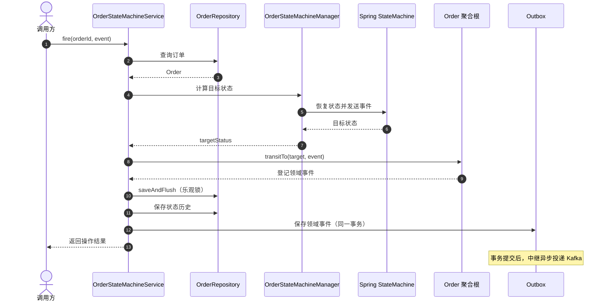

# DDD 订单领域模型与微服务基础示例

## 1. 项目说明

本项目以订单为核心，演示 DDD 战术设计以及微服务常见的基础协作方式：

- DDD：聚合根、值对象、领域服务、策略模式、领域事件、仓储、防腐层、CQRS 读写分离。
- 微服务：独立库存/支付服务、OpenFeign 调用、熔断降级、事务性 Outbox、Kafka 事件、Saga 补偿、接口幂等。
- 工程：Spring Boot 3.2、Spring Data JPA、Spring StateMachine、Spring Kafka、Resilience4j、H2。

订单状态迁移由 Spring StateMachine 判断合法性，聚合根只维护迁移后的内部不变量。

## 2. 项目结构

```text
com/neopen/ddd/
├── OrderApplication.java              # 订单服务启动类
├── application/                       # 应用层
│   ├── dto/                           # 命令、查询条件、视图对象
│   └── service/
│       ├── OrderApplicationService    # 命令侧：用例编排、事务、补偿
│       └── OrderQueryService          # 查询侧：分页、详情、状态历史
├── domain/                            # 领域层（核心，不依赖 Web/Kafka）
│   ├── event/                         # 领域事件与发布端口
│   ├── model/                         # 聚合根、实体、值对象、状态枚举
│   ├── repository/                    # 仓储接口
│   ├── service/                       # 定价领域服务与优惠策略
│   └── statemachine/                  # 状态机配置、Manager、迁移应用服务
├── infrastructure/                    # 基础设施层
│   ├── config/                        # Jackson、Kafka、健康检查
│   ├── exception/                     # 统一异常响应
│   ├── idempotency/                   # 接口幂等记录
│   ├── integration/                   # 库存/支付 ACL 与 Feign 客户端
│   └── messaging/                     # Kafka 发送、Outbox、事件中继
├── interfaces/web/                    # REST 接口
└── mocks/                             # 可独立启动的库存/支付模拟服务
```

### 2.1 分层职责

| 层 | 职责 |
| --- | --- |
| interfaces | HTTP 协议适配、参数校验、调用应用服务 |
| application | 事务边界、用例编排、读写分离、补偿与幂等 |
| domain | 聚合规则、值对象、领域服务、领域事件、状态机、仓储接口 |
| infrastructure | JPA、Outbox、Kafka、Feign、ACL、幂等存储 |

### 2.2 DDD 概念落点

| DDD 概念 | 实现 |
| --- | --- |
| 聚合根 | `Order`（继承 `AggregateRoot`，内部记录领域事件） |
| 实体 | `ProductItem`、`OrderPayment`、`OrderStatusHistory` |
| 值对象 | `Money`（金额 + 币种）、`OrderPricing`（原价/优惠/应付） |
| 领域服务 | `OrderPricingService` |
| 策略模式 | `DiscountPolicy`（满减、折扣），新增规则只需新增实现类 |
| 仓储 | `OrderRepository`、`OrderStatusHistoryRepository` |
| 领域事件 | `OrderCreatedEvent`、`OrderStatusChangedEvent` |
| 防腐层 | `InventoryServiceAcl`、`PaymentServiceAcl` |
| CQRS | `OrderApplicationService`（命令）/ `OrderQueryService`（查询） |

## 3. 领域模型

### 3.1 订单聚合

`Order` 维护订单状态、订单项、金额、优惠、支付记录和库存预占状态。关键规则集中在聚合内部：

- 只有 `CREATED` 状态可修改订单项、记录支付信息、预占库存。
- 订单总额由订单项小计汇总；订单项变化后自动重置优惠。
- 应付金额 = 原始金额 - 优惠金额，由 `OrderPricing` 保证一致。
- 退款时保存 `preStatus`，退款失败由状态机恢复原状态。
- 领域事件在聚合内登记，由应用层在持久化后统一发布。

### 3.2 金额与定价

`Money` 是不可变值对象，统一校验金额非负、币种非空，并提供加减乘和同币种校验。订单、订单项、支付记录均嵌入 `Money`，数据库中金额与币种成对存储。

`OrderPricingService` 汇总订单项金额，在所有可用 `DiscountPolicy` 中选择优惠金额最大的策略：

| 策略 | 规则 |
| --- | --- |
| `FULL_REDUCTION` | 满 100 减 10，满 200 减 20，满 500 减 60 |
| `PERCENTAGE` | 满 200 享 95 折，满 1000 享 9 折 |

### 3.3 订单状态

状态定义以 `OrderStatus`、`OrderEvent` 为准，迁移规则集中在 `OrderStateMachineConfig`。

| 当前状态 | 事件 | 目标状态 | 说明 |
| --- | --- | --- | --- |
| `CREATED` | `PAY` | `PAID` | 支付成功 |
| `CREATED` | `CANCEL` | `CANCELLED` | 未支付取消 |
| `CREATED` | `CLOSE` | `CLOSED` | 超时或异常关闭 |
| `PAID` | `SHIP` | `SHIPPED` | 发货 |
| `PAID` | `CANCEL` | `CANCELLED` | 需配合支付撤销 |
| `PAID` | `REFUND` | `REFUNDING` | 申请退款 |
| `PAID` | `CLOSE` | `CLOSED` | 需处理支付资金 |
| `SHIPPED` | `SIGN` | `DELIVERED` | 确认签收 |
| `SHIPPED` | `REFUND` | `REFUNDING` | 发货后退款 |
| `DELIVERED` | `COMPLETE` | `COMPLETED` | 订单完成 |
| `DELIVERED` | `REFUND` | `REFUNDING` | 签收后退款 |
| `REFUNDING` | `REFUND_SUCCESS` | `REFUNDED` | 退款成功 |
| `REFUNDING` | `REFUND_FAILED` | 原状态 | 退款失败，恢复退款前状态 |

### 3.4 状态迁移时序



## 4. 核心流程

### 4.1 创建订单

1. 校验命令并构建订单项，`OrderPricingService` 计算优惠与应付金额。
2. 通过 `InventoryServiceAcl` 逐项预占库存。
3. 创建 `Order` 聚合并标记库存已预占。
4. 同一事务保存订单、状态历史、Outbox 事件。
5. 保存失败时释放已预占库存，完成 Saga 补偿。

创建接口支持 `Idempotency-Key` 请求头；重复请求直接返回首次结果，不会重复预占库存。

### 4.2 支付订单

1. 先检查幂等记录；订单已是 `PAID` 时直接返回成功结果。
2. 通过支付 ACL 发起支付，支付记录金额取订单应付金额。
3. 状态机校验 `PAY` 事件后迁移为 `PAID`。
4. 保存订单、支付信息、状态历史和 Outbox 事件。

### 4.3 取消/关闭订单

- 待支付订单先释放预占库存，再迁移状态。
- 已支付订单先撤销支付，再迁移状态。
- 库存释放失败时终止操作，避免订单状态已变更但库存未归还。

### 4.4 领域事件与 Outbox

1. 聚合根在创建或状态迁移时登记领域事件。
2. `OutboxDomainEventPublisher` 将事件写入 `tab_outbox_event`，并在进程内发布事件。
3. `OutboxRelay` 定时扫描 `PENDING` 事件，投递到 Kafka 后标记 `PUBLISHED`。
4. 投递失败累计重试次数，超过上限标记 `FAILED`，便于人工处理。
5. 进程内监听器在事务提交后执行日志等本地副作用。

`tab_outbox_event` 使用 `event_id` 唯一约束，保证同一次业务事务不会重复产生相同事件。

## 5. 微服务协作

### 5.1 模拟服务

项目内置两个可独立启动的内存服务：

| 服务 | 端口 | 接口 |
| --- | --- | --- |
| inventory-service | 9001 | `POST /api/inventory/reserve`、`POST /api/inventory/release`、`GET /api/inventory/{productId}` |
| payment-service | 9002 | `POST /api/payments/process`、`POST /api/payments/cancel`、`GET /api/payments/{orderNum}` |

库存服务使用 CAS 维护内存库存；支付服务按订单号幂等，重复请求返回首次交易结果。

### 5.2 调用与容错

- OpenFeign 调用库存/支付服务，地址由 `inventory.service.url`、`payment.service.url` 配置。
- Feign 集成 Resilience4j 熔断，调用失败时通过 FallbackFactory 返回失败结果。
- ACL 将外部协议与异常转换为领域可理解的布尔结果，业务层不依赖 Feign 类型。

### 5.3 接口幂等

`IdempotencyService` 以 `scope + 幂等键` 唯一标识一次操作，首次执行结果保存到 `tab_idempotency_record`。当前用于创建订单和支付订单：

- `POST /api/orders`：可选 `Idempotency-Key`
- `POST /api/orders/{id}/pay`：可选 `Idempotency-Key`

生产环境还应结合唯一索引冲突重试、幂等键过期清理和支付渠道侧幂等。

## 6. 运行方式

### 6.1 启动模拟服务

```bash
mvn -Pmock-inventory spring-boot:run
mvn -Pmock-payment spring-boot:run
```

### 6.2 启动订单服务

```bash
mvn spring-boot:run
```

启动后：

- 订单服务：`http://localhost:8080`
- H2 控制台：`http://localhost:8080/h2`，JDBC URL `jdbc:h2:mem:orderdb`
- 健康检查：`http://localhost:8080/actuator/health`

### 6.3 Kafka（可选）

默认关闭 Kafka，便于无中间件环境演示：

```yaml
app:
  messaging:
    kafka-enabled: false
    consumer-enabled: false
  outbox:
    relay-enabled: true
```

关闭时 Outbox 中继只记录日志并将事件标记为已处理。若已启动 Kafka，将 `kafka-enabled` 与 `consumer-enabled` 设为 `true` 即可投递和消费 `order-events`。

## 7. HTTP 接口

| 方法 | 路径 | 说明 |
| --- | --- | --- |
| POST | `/api/orders` | 创建订单，支持 `Idempotency-Key` |
| POST | `/api/orders/demo` | 创建随机演示订单 |
| GET | `/api/orders` | 分页查询，支持 `status`、`customerId`、`orderNum` |
| GET | `/api/orders/{id}` | 订单详情（含订单项和支付信息） |
| GET | `/api/orders/{id}/history` | 状态流转历史 |
| POST | `/api/orders/{id}/pay` | 支付，支持 `Idempotency-Key` |
| POST | `/api/orders/{id}/ship` | 发货 |
| POST | `/api/orders/{id}/receive` | 确认收货 |
| POST | `/api/orders/{id}/complete` | 完成订单 |
| POST | `/api/orders/{id}/cancel` | 取消订单 |
| POST | `/api/orders/{id}/refund` | 申请退款 |
| POST | `/api/orders/{id}/refund/succeeded` | 退款成功回执 |
| POST | `/api/orders/{id}/refund/failed` | 退款失败回执 |
| POST | `/api/orders/{id}/close` | 关闭订单 |

创建订单示例：

```bash
curl -X POST http://localhost:8080/api/orders \
  -H "Content-Type: application/json" \
  -H "Idempotency-Key: create-1001-001" \
  -d '{
    "customerId": 1001,
    "items": [
      {"productId": 11, "productName": "机械键盘", "quantity": 1, "price": 100.00}
    ]
  }'
```

查询示例：

```bash
curl "http://localhost:8080/api/orders?page=0&size=10&customerId=1001"
curl http://localhost:8080/api/orders/1
curl http://localhost:8080/api/orders/1/history
```

## 8. 一致性与可靠性说明

已实现：

- 创建订单库存预占失败/订单落库失败时释放库存。
- 取消或关闭待支付订单时释放库存。
- 支付与创建接口幂等。
- 领域事件与业务数据同事务写入 Outbox，异步投递 Kafka。
- 状态迁移使用 JPA 乐观锁（`@Version`）拦截并发修改。

仍需生产化增强：

- 库存预占超时、预占对账和 Saga 状态持久化。
- 支付回调验签、主动对账、退款资金流水。
- 幂等键过期清理与并发唯一约束冲突的自动重放。
- Outbox 失败事件的告警、人工补偿和归档。

## 9. 测试

```bash
mvn test
```

覆盖内容包括：聚合状态迁移与退款恢复、金额与定价策略选择、订单查询分页与详情、状态机集成迁移、订单创建到支付的全链路集成。当前共 19 个测试用例。

`OrderCreatePayFlowIntegrationTest` 以 HTTP 接口为入口串联完整流程：

1. 创建订单：校验原价、优惠、应付金额与命中的折扣策略。
2. 幂等重放：相同 `Idempotency-Key` 重复创建返回同一订单。
3. 支付订单：校验 `PAID` 状态与支付金额取自应付金额。
4. 幂等重放：相同 `Idempotency-Key` 重复支付返回首次结果。
5. 查询详情与状态历史：确认支付记录、库存预占标记与 `CREATE`、`PAY` 两条历史。
6. 校验库存只预占一次、支付 ACL 被调用，且 Outbox 中存在创建与状态变更事件。
