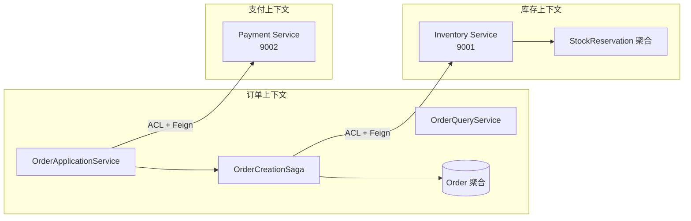

# 01 · DDD 战术设计：从上下文到代码

本文回答三个问题：**边界怎么划、模型怎么建、依赖怎么指**。所有结论都对应到项目中的真实代码。

## 1. 为什么需要限界上下文

订单、库存、支付三个概念看起来都围绕“商品”，但它们的规则完全不同：

| 上下文 | 核心问题 | 关键模型 | 变更频率 |
| --- | --- | --- | --- |
| 订单（核心域） | 这笔交易是否成立、处于什么状态 | `Order` 聚合、金额、状态机 | 高 |
| 库存（支撑域） | 商品是否可售、占用何时释放 | `StockReservation` 聚合 | 中 |
| 支付（通用域） | 资金是否扣减/撤销 | 支付单、交易号 | 低 |

如果把三者塞进一个 `OrderService` 和一个 `Order` 实体，会出现典型症状：订单表里出现库存字段、支付回调直接改订单状态、任何一方改字段都要全量回归。**限界上下文的作用是让每个模型只表达自己领域的语言。**

本项目用两种方式体现边界：

1. **进程边界**：库存（9001）、支付（9002）是可独立启动的模拟服务。
2. **包边界 + 构建期约束**：`com.neopen.ddd.domain`、`application`、`infrastructure`、`interfaces`、`mocks` 各自职责固定，由 ArchUnit 检查（见 07）。

## 2. 上下文映射



关系说明：

- **防腐层（ACL）**：订单服务不直接使用库存/支付的 DTO 与异常，`InventoryServiceAcl`、`PaymentServiceAcl` 把它们翻译成布尔值或预占单号。
- **按 ID 引用**：订单只保存 `reservationId`、支付单号，不持有对方的对象，避免跨上下文共享模型。
- **发布语言**：跨服务事件统一使用 `contracts.IntegrationEvent` 信封，见 06。

## 3. 分层与依赖方向

```text
interfaces  →  application  →  domain
                    ↓
              infrastructure（实现 domain 端口）
```

| 层 | 包 | 职责 | 禁止 |
| --- | --- | --- | --- |
| 接口层 | `interfaces.web` | HTTP 协议适配、参数校验、调用应用服务 | 直接访问仓储、Feign、数据库 |
| 应用层 | `application` | 事务边界、用例编排、Saga、读写分离 | 实现领域规则 |
| 领域层 | `domain` | 聚合不变量、值对象、领域服务、事件、仓储接口 | 依赖 Web/Kafka/Feign |
| 基础设施层 | `infrastructure` | JPA、Outbox、Kafka、Feign、ACL、幂等、投影 | 反向依赖接口层 |
| 模拟服务 | `mocks` | 独立微服务的进程内模拟 | 依赖订单服务内部模型 |

关键点：**领域层不依赖基础设施，依赖方向由接口倒置。** `OrderRepository` 定义在 `domain.repository`，JPA 实现由 Spring Data 提供；`DomainEventPublisher` 定义在 `domain.event`，Outbox 实现位于 `infrastructure.messaging`。

## 4. 战术构件与本项目落点

### 4.1 聚合与聚合根

| 聚合根 | 一致性边界 | 内部实体/值对象 |
| --- | --- | --- |
| `Order` | 订单状态、金额、订单项、支付记录、预占标记 | `ProductItem`、`OrderPayment`、`Money`、`OrderPricing` |
| `StockReservation` | 预占单状态与数量 | 无（自身即最小一致性单元） |

设计原则与代码对应：

- **一个事务只改一个聚合**：创建订单只修改 `Order`，库存通过远程预占单表达，不加入订单事务。
- **外部只能通过聚合根修改内部**：`ProductItem` 的 `order` 字段由 `Order.create` 装配，`Order.transitTo` 是唯一状态变更入口。
- **聚合内维护不变量**：应付金额 = 原价 - 优惠，由 `OrderPricing` 与 `Order.create` 保证。

### 4.2 实体与值对象

**值对象 `Money`**

- 不可变；构造时校验金额非负、币种非空。
- 提供加减乘运算，并要求同币种，避免“100 CNY + 100 USD”这类错误。
- 数据库中以 `amount + currency` 成对存储（见 02 的字段映射表）。

**值对象 `OrderPricing`**

- 保存原价、优惠金额、应付金额与命中的策略编码。
- 通过构造校验三者关系，防止出现“应付大于原价”或“优惠为负”。

**实体**

- `ProductItem`：订单项，含商品快照（名称、单价）与 `reservationId`。
- `OrderPayment`：支付回执，与订单一对一。
- `OrderStatusHistory`：状态迁移审计记录，独立表 `order_status_history`。

### 4.3 领域服务与策略

`OrderPricingService` 汇总订单项金额，并在所有 `DiscountPolicy` 实现中挑选**优惠金额最大**的一个：

| 策略实现 | 规则 |
| --- | --- |
| 满减 | 满 100 减 10、满 200 减 20、满 500 减 60 |
| 折扣 | 满 200 享 95 折、满 1000 享 9 折 |

新增规则不需要修改订单聚合，只需新增 `DiscountPolicy` 实现并注册为 Spring Bean，符合开闭原则。

### 4.4 领域事件

采用“**聚合内登记、应用层拉取发布**”模式：

1. `AggregateRoot.registerEvent(...)` 把事件暂存在聚合内部。
2. 应用层在持久化成功后调用 `pullDomainEvents()`。
3. `OutboxDomainEventPublisher` 在同一事务写入 `tab_outbox_event`，并发布进程内事件。
4. `OutboxRelay` 异步投递 Kafka；本地监听器同步更新读模型。

这样既保证“事件不早于数据”，又避免聚合直接依赖消息中间件。

### 4.5 仓储

- `OrderRepository`、`OrderStatusHistoryRepository` 定义在领域层。
- 查询使用 Spring Data `Specification` 组合条件；写模型查询与读模型查询分离（见 06）。
- 仓储只暴露聚合级别的方法，不暴露“改某个字段”的 SQL 式操作。

## 5. 常见误区与本项目的处理

| 误区 | 后果 | 本项目做法 |
| --- | --- | --- |
| 把库存当订单字段直接扣减 | 订单失败后库存永久丢失 | 库存预占单 + TTL + 补偿释放 |
| 在实体 setter 里做状态校验 | 规则分散、绕过状态机 | 状态迁移统一走 `Order.transitTo` + 状态机 |
| 领域层直接发 Kafka | 领域模型绑定中间件，测试困难 | 领域事件 + Outbox 端口 |
| 读模型复用写模型 | 展示需求反向污染聚合 | 投影表 `tab_order_summary_view` |
| 用“是否成功”布尔值描述外部调用 | 丢失预占单号，无法精确补偿 | ACL 返回预占单号 |
| 只靠文档约定分层 | 边界随时间腐化 | ArchUnit 构建期断言 |

## 6. 代码导读

| 关注点 | 入口 |
| --- | --- |
| 聚合与不变量 | `domain/model/Order.java`、`domain/model/Money.java` |
| 定价策略 | `domain/service/OrderPricingService.java`、`domain/service/DiscountPolicy.java` |
| 状态机 | `domain/statemachine/` |
| 命令编排 | `application/service/OrderApplicationService.java` |
| 创建 Saga | `application/saga/OrderCreationSaga.java` |
| 防腐层 | `infrastructure/integration/*/acl/` |
| 事件与 Outbox | `domain/event/`、`infrastructure/messaging/outbox/` |
| 读模型 | `infrastructure/readmodel/` |
| 接口 | `interfaces/web/OrderController.java`、`OrderReadModelController.java` |

下一篇：[02 · 订单聚合与状态机](./02-order-aggregate-and-statemachine.md)
