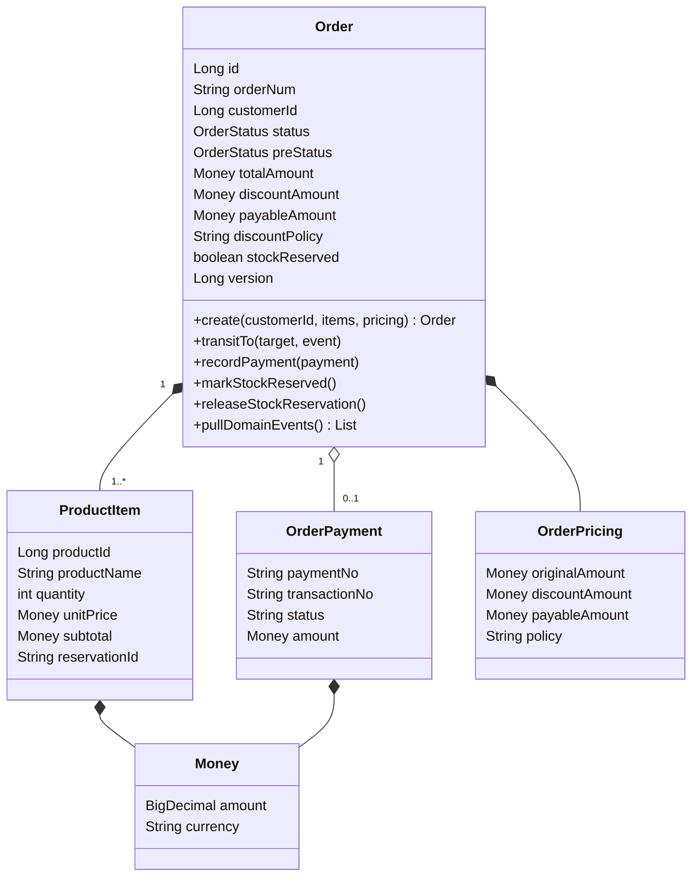
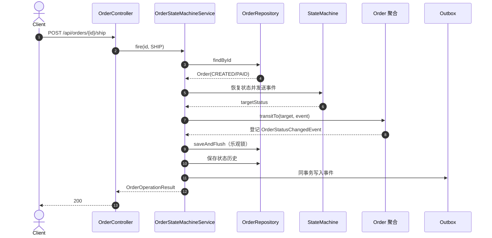

# 02 · 订单聚合与状态机

本文聚焦订单写模型：字段与不变量、金额模型、状态迁移、并发控制与审计。

## 1. 聚合结构

## 2. 字段与表映射

表名 `tab_order`，唯一约束 `uk_orders_order_num`。

| 字段 | 列 | 说明 |
| --- | --- | --- |
| `orderNum` | `order_num` | 业务订单号，创建后不可更新 |
| `customerId` | `customer_id` | 客户标识，跨上下文只存 ID |
| `status` | `status` | 枚举字符串，便于直接阅读 |
| `preStatus` | `pre_status` | 退款前状态，退款失败时恢复 |
| `totalAmount` | `total_amount` + `total_currency` | 优惠前总额 |
| `discountAmount` | `discount_amount` + `discount_currency` | 优惠金额 |
| `payableAmount` | `payable_amount` + `payable_currency` | 应付金额 |
| `discountPolicy` | `discount_policy` | 命中的策略编码，便于排查 |
| `orderPayment` | `payment_id` | 一对一，唯一外键 |
| `stockReserved` | `stock_reserved` | 是否已预占库存，取消时据此补偿 |
| `version` | `version` | JPA 乐观锁 |

`ProductItem` 新增 `reservation_id`，保存库存服务返回的预占单号。

## 3. 聚合不变量

1. 订单创建后初始状态为 `CREATED`，订单号唯一。
2. 订单总额 = 所有订单项小计之和；订单项变化后优惠重置。
3. 应付金额 = 原价 - 优惠，优惠金额不得超过原价。
4. 只有 `CREATED` 状态可以修改订单项、记录支付、预占库存。
5. 退款进入 `REFUNDING` 时保存 `preStatus`；退款失败恢复该状态。
6. 已预占库存的订单取消/关闭时必须释放预占，且只能释放一次。

这些规则写在 `Order` 内部，外部无法绕过；应用层只负责编排与事务。

## 4. 状态机

### 4.1 职责分离

| 组件 | 位置 | 职责 |
| --- | --- | --- |
| `OrderStateMachineConfig` | `domain/statemachine` | 声明状态、事件与合法迁移边 |
| `OrderStateMachineManager` | `domain/statemachine` | 根据当前状态与事件计算目标状态 |
| `OrderStateMachineService` | `domain/statemachine` | 事务内执行迁移、写历史、写 Outbox |
| `Order` | `domain/model` | 应用目标状态并维护内部不变量 |

聚合根不再维护第二份迁移表，避免“状态机允许、聚合拒绝”的双重规则。

### 4.2 全量迁移表

| 当前状态 | 事件 | 目标状态 | 触发接口 |
| --- | --- | --- | --- |
| `CREATED` | `PAY` | `PAID` | `POST /api/orders/{id}/pay` |
| `CREATED` | `CANCEL` | `CANCELLED` | `POST /api/orders/{id}/cancel` |
| `CREATED` | `CLOSE` | `CLOSED` | `POST /api/orders/{id}/close` |
| `PAID` | `SHIP` | `SHIPPED` | `POST /api/orders/{id}/ship` |
| `PAID` | `CANCEL` | `CANCELLED` | 取消（需先撤销支付） |
| `PAID` | `REFUND` | `REFUNDING` | `POST /api/orders/{id}/refund` |
| `PAID` | `CLOSE` | `CLOSED` | 关闭（需处理资金） |
| `SHIPPED` | `SIGN` | `DELIVERED` | `POST /api/orders/{id}/receive` |
| `SHIPPED` | `REFUND` | `REFUNDING` | 发货后退款 |
| `DELIVERED` | `COMPLETE` | `COMPLETED` | `POST /api/orders/{id}/complete` |
| `DELIVERED` | `REFUND` | `REFUNDING` | 签收后退款 |
| `REFUNDING` | `REFUND_SUCCESS` | `REFUNDED` | `POST /api/orders/{id}/refund/succeeded` |
| `REFUNDING` | `REFUND_FAILED` | 原状态 | `POST /api/orders/{id}/refund/failed` |

终态：`COMPLETED`、`CANCELLED`、`REFUNDED`、`CLOSED`，不再接受业务事件。

### 4.3 状态迁移时序

## 5. 金额与定价

- `Money` 是值对象：金额 + 币种，禁止负值，运算要求同币种。
- `OrderPricingService` 汇总金额后遍历全部 `DiscountPolicy`，选择优惠最大者。
- 无可用策略时返回 `NONE` 与零优惠。

创建订单时定价发生在 Saga 的 `PRICE` 步骤，定价结果同时用于：

1. 订单聚合的金额字段；
2. 支付 ACL 的支付金额；
3. 读模型展示字段。

## 6. 并发控制

- 订单使用 `@Version` 乐观锁；并发支付或并发迁移时，后提交者收到乐观锁异常，全局异常处理器映射为 HTTP 409。
- 创建订单时使用 `saveAndFlush` 立即触发约束与版本校验，避免异常延迟到事务提交后无法补偿。
- 状态历史表不参与乐观锁，仅追加写入。

## 7. 状态历史与审计

表 `order_status_history`：

| 列 | 说明 |
| --- | --- |
| `order_id` | 订单主键 |
| `from_status` | 迁移前状态，创建时为空 |
| `to_status` | 迁移后状态 |
| `event` | 触发事件（CREATE、PAY、SHIP…） |
| `operator_id` | 操作人，系统操作可为空 |
| `remark` | 备注 |
| `created_at` | 记录时间 |

查询接口：`GET /api/orders/{id}/history`，按时间与主键升序返回，还原真实顺序。

## 8. 常见问题

| 现象 | 原因 | 处理 |
| --- | --- | --- |
| 支付返回 409 | 并发支付或订单被其他事务修改 | 重新查询订单状态后重试 |
| 取消提示“释放库存失败” | 预占单已过期或库存服务不可用 | 查看预占单状态与库存服务日志，走对账补偿 |
| 退款失败后状态不对 | `preStatus` 未正确恢复 | 检查 `REFUND_FAILED` 事件与聚合恢复逻辑 |
| 金额与订单项不一致 | 绕过聚合直接改订单项 | 一律通过聚合方法修改，并重新定价 |

下一篇：[03 · 微服务协作](./03-microservice-collaboration.md)
