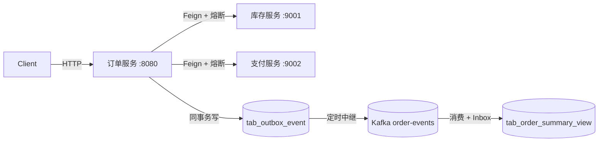
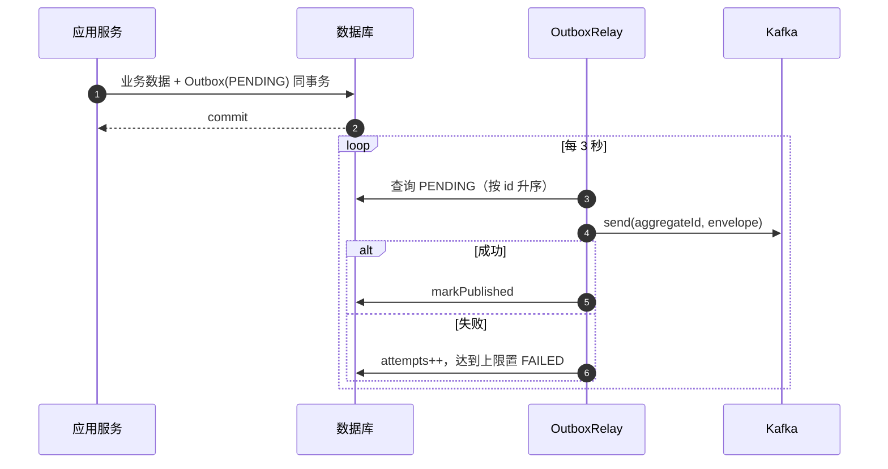

# 03 · 微服务协作：ACL、Feign、幂等与 Outbox

本文说明订单服务如何与库存、支付两个独立服务协作，以及如何在不共享数据库的前提下保证最终一致。

## 1. 协作全景



四条协作原则：

1. **不共享数据库**：库存与支付各自维护状态，订单只保存引用。
2. **不共享模型**：通过 DTO 与集成事件契约交互，避免领域模型跨服务泄漏。
3. **不假设远程事务**：外部调用失败靠补偿与预占 TTL 兜底。
4. **所有入口可重试**：接口幂等 + 事件去重。

## 2. 模拟服务

### 2.1 库存服务（端口 9001）

| 方法 | 路径 | 说明 |
| --- | --- | --- |
| POST | `/api/inventory/reservations` | 创建预占单 |
| POST | `/api/inventory/reservations/{id}/confirm` | 确认预占 |
| POST | `/api/inventory/reservations/{id}/release` | 释放预占 |
| GET | `/api/inventory/reservations/{id}` | 查询预占单 |
| GET | `/api/inventory/{productId}` | 查询可售库存 |

创建预占请求：

```json
{
  "productId": 11,
  "quantity": 2,
  "orderNum": "ORD-20261120-ABC123",
  "ttlSeconds": 900
}
```

成功响应：

```json
{
  "success": true,
  "status": "PENDING",
  "message": "库存预占成功",
  "reservationId": "RSV-3f2a9c81b7d04e55",
  "data": 998
}
```

### 2.2 支付服务（端口 9002）

| 方法 | 路径 | 说明 |
| --- | --- | --- |
| POST | `/api/payments/process` | 发起支付，按订单号幂等 |
| POST | `/api/payments/cancel` | 撤销支付 |
| GET | `/api/payments/{orderNum}` | 查询交易结果 |

支付服务内部按订单号保存首次交易结果，重复 `process` 返回同一结果，避免渠道侧重复扣款。

启动方式：

```bash
mvn -Pmock-inventory spring-boot:run
mvn -Pmock-payment spring-boot:run
```

## 3. 防腐层（ACL）

### 3.1 职责

`InventoryServiceAcl` 与 `PaymentServiceAcl` 位于 `infrastructure/integration/*/acl`，负责：

- 把领域参数翻译为外部 DTO；
- 调用 Feign 客户端；
- 把异常、降级统一收敛为可判断的结果；
- 不把 Feign 类型、HTTP 状态码泄漏到应用层。

库存 ACL 的方法语义：

| 方法 | 返回 | 说明 |
| --- | --- | --- |
| `reserveStock(productId, quantity, orderNum)` | 预占单号或 `null` | `null` 表示库存不足、服务不可用或降级 |
| `confirmStock(reservationId)` | `boolean` | 支付成功后确认预占 |
| `releaseStock(reservationId)` | `boolean` | 取消/失败时释放预占 |

**为什么返回预占单号而不是布尔值**：布尔值只能表达“成功”，丢失了“占用了哪一笔库存”的信息，失败时无法精确补偿。预占单号让补偿具备幂等目标。

### 3.2 Feign 与超时

```yaml
spring:
  cloud:
    openfeign:
      circuitbreaker:
        enabled: true
      client:
        config:
          inventory-client:
            connectTimeout: 2000
            readTimeout: 3000
          payment-client:
            connectTimeout: 2000
            readTimeout: 3000
```

超时时间短于用户可接受的响应时间，失败快速返回，避免线程长时间占用。

### 3.3 熔断与降级

```yaml
resilience4j:
  circuitbreaker:
    configs:
      default:
        slidingWindowSize: 10
        minimumNumberOfCalls: 5
        failureRateThreshold: 50
        waitDurationInOpenState: 10000
```

- 统计窗口 10 次调用，至少 5 次才开始计算失败率。
- 失败率超过 50% 打开熔断，10 秒后进入半开。
- 降级由 `InventoryClientFallbackFactory` / `PaymentClientFallbackFactory` 返回失败结果，并记录 `cause`。

降级结果与真实业务失败在应用层表现一致：库存视为不可用，订单创建失败并进入 Saga 补偿。

## 4. 接口幂等

### 4.1 模型

表 `tab_idempotency_record`，唯一约束为 `scope + idem_key`：

| 列 | 说明 |
| --- | --- |
| `scope` | 用例作用域，如 `ORDER_CREATE`、`ORDER_PAY` |
| `idem_key` | 客户端传入的幂等键 |
| `response` | 首次执行结果的 JSON，用于回放 |
| `created_at` | 记录时间 |

### 4.2 使用方式

```bash
curl -X POST http://localhost:8080/api/orders \
  -H "Content-Type: application/json" \
  -H "Idempotency-Key: create-1001-001" \
  -d '{"customerId":1001,"items":[{"productId":11,"productName":"机械键盘","quantity":1,"price":100.00}]}'
```

```bash
curl -X POST http://localhost:8080/api/orders/1/pay \
  -H "Idempotency-Key: pay-1-001"
```

- 相同幂等键重复请求直接返回首次结果，不重复预占库存或扣款。
- 未传幂等键时退化为业务级幂等：已支付订单再次支付直接返回成功。

### 4.3 边界

- 幂等记录与业务写在同一事务内，业务回滚则记录不生效。
- 生产环境需补充：幂等键 TTL 清理、唯一冲突自动重放、跨实例时钟与请求指纹校验。

## 5. 事务性 Outbox

### 5.1 为什么要 Outbox

“先写数据库、再发 Kafka”会出现两类问题：写库成功但发消息失败（丢事件），或发消息成功但事务回滚（幽灵事件）。Outbox 把“事件”当成业务数据的一部分：

1. 业务事务内写 `tab_outbox_event`；
2. 事务提交后由中继异步投递；
3. 投递成功标记 `PUBLISHED`，失败累计次数。

### 5.2 表结构

| 列 | 说明 |
| --- | --- |
| `event_id` | 事件唯一 ID，唯一约束防重 |
| `aggregate_type` / `aggregate_id` | 聚合信息，`aggregate_id` 作为 Kafka key |
| `event_type` | 事件类型 |
| `payload` | 集成事件信封 JSON |
| `status` | `PENDING` / `PUBLISHED` / `FAILED` |
| `attempts` | 失败次数 |
| `last_error` | 最近失败原因 |
| `published_at` | 投递成功时间 |

### 5.3 投递流程



### 5.4 事件信封示例

```json
{
  "eventId": "b1f0c7d8-7a0e-4c7e-9b3f-2a0d1e5c6f70",
  "eventType": "OrderCreatedEvent",
  "version": 1,
  "aggregateType": "Order",
  "aggregateId": "1001",
  "occurredAt": "2026-11-20T04:30:12.345Z",
  "payload": {
    "orderNum": "ORD-20261120-ABC123",
    "customerId": 1001,
    "payableAmount": {"amount": 90.00, "currency": "CNY"}
  }
}
```

信封的作用见 06：稳定元数据 + 可演进载荷。

### 5.5 开关与降级

```yaml
app:
  messaging:
    kafka-enabled: false        # 未启动 Kafka 时只记录日志
    order-events-topic: order-events
    consumer-group: order-ddd-consumer
    consumer-enabled: false
  outbox:
    relay-enabled: true
    relay-interval-ms: 3000
    max-attempts: 5
```

关闭 Kafka 时，Outbox 仍然落库，中继只记录日志并把事件标记为已处理，保证本地流程完整可跑。

## 6. 失败模式矩阵

| 失败点 | 表现 | 兜底机制 |
| --- | --- | --- |
| 库存服务超时/熔断 | `reserveStock` 返回 `null` | 重试后仍失败 → Saga 补偿 |
| 库存不足 | `success=false` | 直接失败，无需补偿 |
| 支付服务超时 | `processPayment` 返回 `false` | 不写支付记录，订单保持 `CREATED` |
| 支付成功但本地迁移失败 | 资金已扣、订单未变 | 对账任务/人工补偿（示例未实现） |
| 订单落库失败 | 本地事务回滚 | 释放已创建预占单 |
| Kafka 不可用 | Outbox 持续 `PENDING` | 中继重试，超限标记 `FAILED` |
| 重复请求 | 幂等记录命中 | 回放首次响应 |
| 重复消息 | Inbox 命中 | 跳过消费 |

## 7. 排查清单

1. 库存/支付服务是否启动：`curl localhost:9001/api/inventory/1`、`curl localhost:9002/api/payments/demo`。
2. 熔断是否打开：`GET /actuator/circuitbreakers`。
3. Outbox 是否堆积：查询 `tab_outbox_event` 中 `status='PENDING'` 且 `attempts>0` 的记录。
4. 一致性是否漂移：对比订单状态、预占单状态与读模型状态。
5. Feign 日志：将 `com.neopen.ddd.infrastructure.integration` 日志级别调为 `DEBUG`。

下一篇：[04 · 持久化 Saga](./04-persistent-saga.md)
