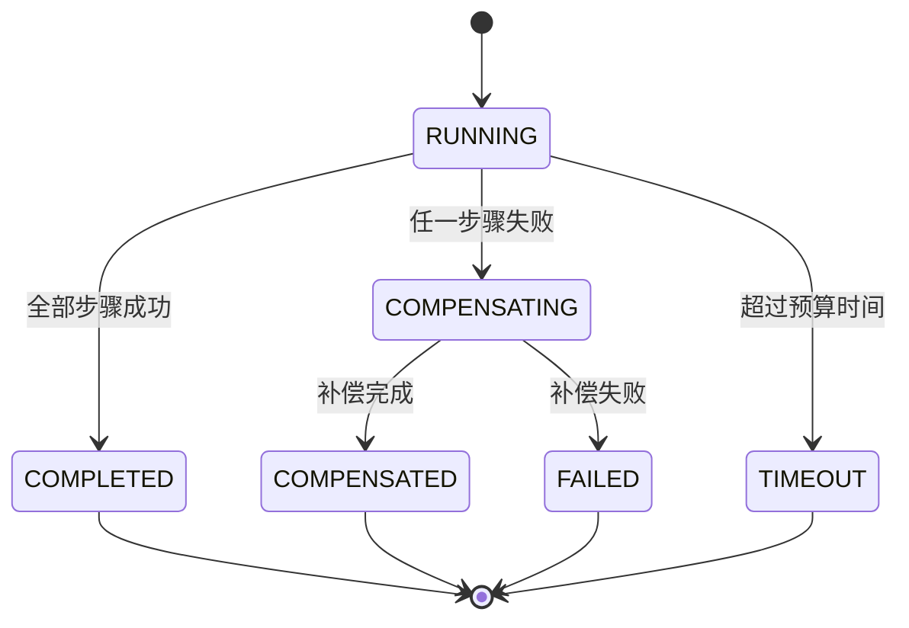
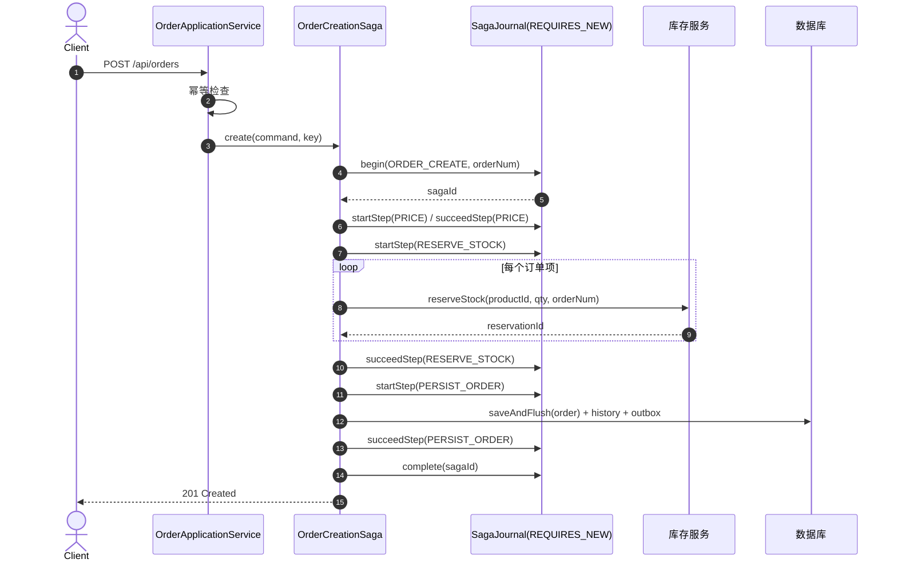
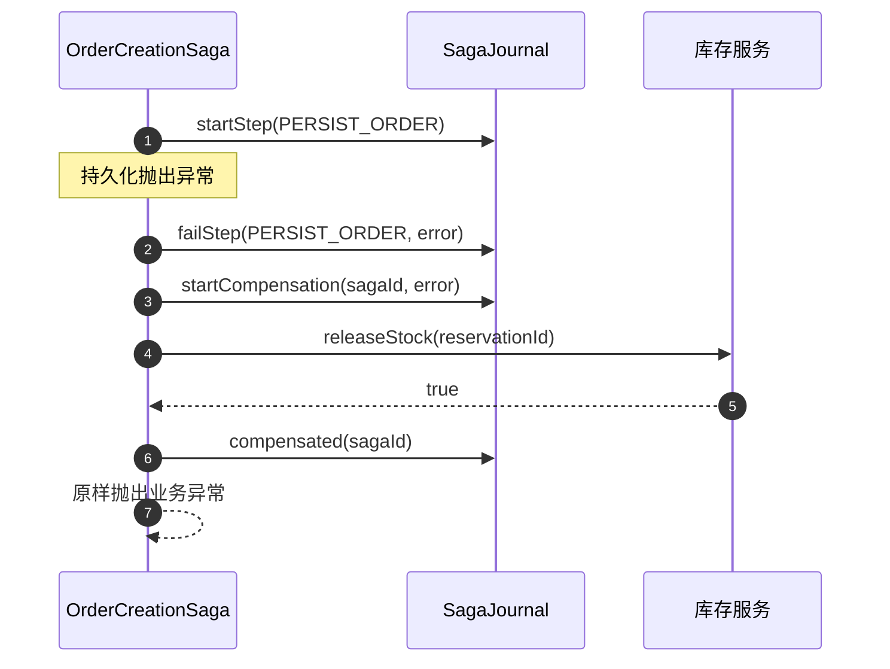

# 04 · 持久化 Saga：跨服务流程编排

创建订单要同时完成“本地写库”和“远端预占库存”，二者无法共享事务。Saga 用**正向步骤 + 反向补偿**表达这个过程，并把每一步固化到数据库，让失败可追溯、可补偿、可告警。

## 1. 编排式还是协同式

| 方式 | 说明 | 本项目选择 |
| --- | --- | --- |
| 编排式 (Orchestration) | 由一个编排器显式调用各服务并决定补偿 | ✅ `OrderCreationSaga` |
| 协同式 (Choreography) | 各服务监听事件自行推进 | 仅用于读模型投影等旁路 |

订单创建步骤少、顺序强、需要统一补偿，编排式更易理解和排障。

## 2. 数据模型

### 2.1 `tab_saga_instance`

| 列 | 说明 |
| --- | --- |
| `saga_id` | 业务标识，唯一 |
| `saga_type` | 流程类型，当前为 `ORDER_CREATE` |
| `business_key` | 业务键，取订单号 |
| `status` | `RUNNING` / `COMPLETED` / `COMPENSATING` / `COMPENSATED` / `FAILED` / `TIMEOUT` |
| `current_step` | 当前或最后执行的步骤 |
| `error_message` | 失败原因（截断 1000 字符） |
| `started_at` / `finished_at` | 起止时间 |
| `updated_at` | 最后更新时间，超时任务据此判断 |
| `version` | 乐观锁 |

### 2.2 `tab_saga_step`

| 列 | 说明 |
| --- | --- |
| `saga_id` + `step_name` | 唯一约束，重试复用同一行 |
| `status` | `PENDING` / `RUNNING` / `SUCCEEDED` / `FAILED` / `COMPENSATED` |
| `attempts` | 尝试次数 |
| `error_message` | 失败原因 |
| `started_at` / `finished_at` | 起止时间 |



## 3. 步骤定义

| 步骤 | 类型 | 动作 | 补偿 |
| --- | --- | --- | --- |
| `PRICE` | 本地 | 构建订单项、计算优惠与应付金额 | 无需补偿 |
| `RESERVE_STOCK` | 外部 | 逐项调用库存服务创建预占单 | 释放已创建的预占单 |
| `PERSIST_ORDER` | 本地 | 保存订单、状态历史、Outbox | 随事务回滚；预占由前一步补偿释放 |

失败注入点同样以这三个步骤名为准。

## 4. 执行时序



失败分支：



## 5. 为什么必须独立事务

`SagaJournal` 的所有写方法都声明 `Propagation.REQUIRES_NEW`：

```java
@Transactional(propagation = Propagation.REQUIRES_NEW)
public void failStep(String sagaId, String stepName, String error) {
    stepRepository.findBySagaIdAndStepName(sagaId, stepName)
            .ifPresent(step -> step.fail(error));
}
```

原因：

- 业务主事务失败会回滚订单、历史、Outbox；
- 如果 Saga 轨迹共用该事务，失败证据也会消失；
- 独立事务提交后，即使业务回滚，仍能查到“哪个步骤失败、失败原因、是否补偿”。

代价：Saga 写入会额外占用连接并提交小事务，因此只在“每步骤一次”的粒度调用，不要放进高频循环。

## 6. 重试、超时与故障注入

### 6.1 有限重试

库存预占失败时按 `app.saga.reserve-max-attempts` 重试（默认 2 次）。重试只针对外部调用，本地步骤失败直接进入补偿。

### 6.2 超时看门狗

`SagaTimeoutJob` 每 60 秒扫描一次：

- 条件：`status = RUNNING` 且 `updated_at < now - timeout-seconds`（默认 300 秒）；
- 动作：标记为 `TIMEOUT` 并记录日志；
- 单轮最多处理 20 条，避免长事务。

超时只负责“暴露悬挂”，不会自动补偿，因为此时无法确定外部调用是否已经生效。

### 6.3 故障注入

```yaml
app:
  saga:
    fault-step: PERSIST_ORDER
```

或启动时指定：

```bash
mvn spring-boot:run -Dspring-boot.run.arguments=--app.saga.fault-step=PERSIST_ORDER
```

命中后在校验步骤时抛出 `IllegalStateException`，用于验证：

1. 前序预占是否被释放；
2. Saga 是否进入 `COMPENSATED`；
3. 订单是否未落库；
4. 接口是否返回 409。

对应测试：`OrderSagaCompensationTest`。

## 7. 配置项

| 配置 | 默认 | 说明 |
| --- | --- | --- |
| `app.saga.reserve-max-attempts` | 2 | 库存预占最大尝试次数 |
| `app.saga.timeout-enabled` | true | 是否启用超时扫描 |
| `app.saga.timeout-seconds` | 300 | 超时阈值 |
| `app.saga.timeout-scan-interval-ms` | 60000 | 扫描间隔 |
| `app.saga.fault-step` | 空 | 故障注入步骤名 |

## 8. 查询接口

```bash
curl http://localhost:8080/api/orders/1/saga
```

响应示例：

```json
{
  "sagaId": "SAGA-8c1d5e7f9a0b4c2d",
  "sagaType": "ORDER_CREATE",
  "businessKey": "ORD-20261120-ABC123",
  "status": "COMPLETED",
  "currentStep": "PERSIST_ORDER",
  "startedAt": "2026-11-20T12:30:10",
  "finishedAt": "2026-11-20T12:30:12",
  "steps": [
    {"stepName": "PRICE", "status": "SUCCEEDED", "attempts": 1},
    {"stepName": "RESERVE_STOCK", "status": "SUCCEEDED", "attempts": 1},
    {"stepName": "PERSIST_ORDER", "status": "SUCCEEDED", "attempts": 1}
  ]
}
```

补偿场景中 `status` 为 `COMPENSATED`，失败步骤为 `FAILED`，`errorMessage` 给出原因。

## 9. 补偿策略的边界

| 场景 | 是否可补偿 | 说明 |
| --- | --- | --- |
| 预占后落库失败 | ✅ | 按预占单号释放 |
| 库存服务不可用 | ⚠️ | 预占未创建，无需补偿；若已创建但释放失败，依赖 TTL 回收 |
| 支付已扣款但订单迁移失败 | ❌ | 需要支付对账/人工退款，Saga 无法跨资金系统撤销 |
| 进程在步骤间崩溃 | ⚠️ | Saga 停留 `RUNNING`，超时任务标记；断点续跑未实现 |

## 10. 生产化增强建议

1. **断点续跑**：持久化命令载荷，支持从失败步骤恢复。
2. **补偿重试队列**：补偿失败进入重试表，指数退避。
3. **Saga 告警**：`FAILED`、`TIMEOUT` 接入监控。
4. **步骤幂等键**：每个外部调用携带步骤级幂等键，支持安全重放。
5. **可视化**：按 `business_key` 聚合展示订单全链路轨迹。

下一篇：[05 · 库存预占聚合](./05-inventory-reservation.md)
