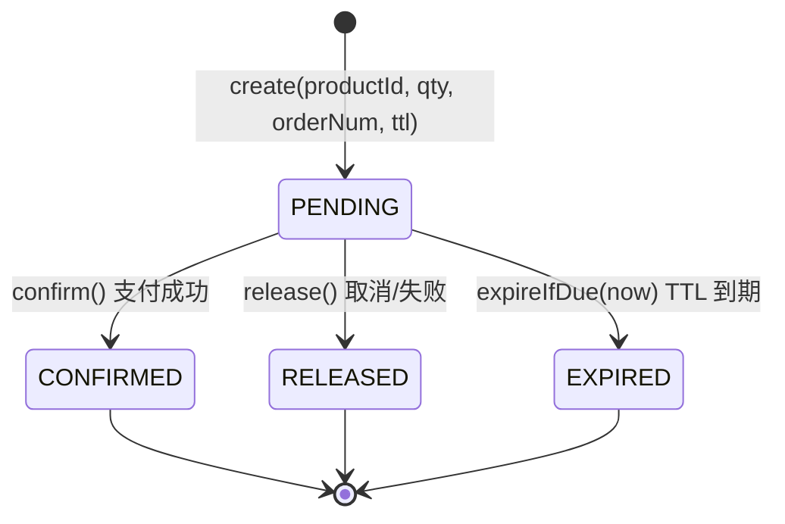

# 05 · 库存预占聚合与 TTL 回收

库存是订单之外最容易出现“悬挂”的上下文。本文说明 `StockReservation` 聚合如何用**状态机 + TTL** 解决跨服务库存占用问题。

## 1. 问题背景

传统做法是下单时直接扣减库存：

```text
reserveStock() -> 库存 -1
```

一旦订单落库失败或服务崩溃，库存永远不会归还。即使写了补偿代码，进程崩溃时补偿也不会执行。

预占模型把“占用”变成一个有生命周期的业务对象：

```text
预占（PENDING） → 支付确认（CONFIRMED）
              ↘ 取消释放（RELEASED）
              ↘ 超时回收（EXPIRED）
```

## 2. 聚合模型



不变量：

1. 只有 `PENDING` 可以确认、释放或过期。
2. `CONFIRMED` 表示库存已被真正消耗，拒绝释放。
3. `RELEASED` / `EXPIRED` 的重复释放保持幂等，返回 `false`，调用方不再归还库存。
4. 数量必须大于 0，订单号不能为空，TTL 必须大于 0。

代码：`com.neopen.ddd.mocks.inventory.domain.StockReservation`。

## 3. 库存扣减与并发

库存服务使用 `ConcurrentHashMap<Long, AtomicInteger>` 保存可售库存，预占时执行 CAS 循环：

```java
while (true) {
    int available = stock.get();
    if (available < quantity) {
        return fail("库存不足，剩余 " + available);
    }
    if (stock.compareAndSet(available, available - quantity)) {
        // 创建预占单
    }
}
```

- 不使用锁，避免热点商品串行化。
- `compareAndSet` 失败说明有并发的其他预占，重读最新值后重试。
- 预占单创建与库存扣减在同一个请求内完成；演示场景不做持久化，重启即重置。

## 4. HTTP 契约

### 4.1 创建预占

```bash
curl -X POST http://localhost:9001/api/inventory/reservations \
  -H "Content-Type: application/json" \
  -d '{"productId":11,"quantity":2,"orderNum":"ORD-DEMO-1","ttlSeconds":900}'
```

```json
{
  "success": true,
  "status": "PENDING",
  "message": "库存预占成功",
  "reservationId": "RSV-3f2a9c81b7d04e55",
  "data": 998
}
```

`data` 为预占后的剩余库存。

### 4.2 确认预占

```bash
curl -X POST http://localhost:9001/api/inventory/reservations/RSV-3f2a9c81b7d04e55/confirm
```

```json
{"success":true,"status":"CONFIRMED","reservationId":"RSV-3f2a9c81b7d04e55"}
```

### 4.3 释放预占

```bash
curl -X POST http://localhost:9001/api/inventory/reservations/RSV-3f2a9c81b7d04e55/release
```

释放成功后库存归还；重复释放返回成功但不会再次加库存。

### 4.4 查询

```bash
curl http://localhost:9001/api/inventory/reservations/RSV-3f2a9c81b7d04e55
curl http://localhost:9001/api/inventory/11
```

## 5. TTL 回收

`InventoryMockController.expireReservations()` 每 5 秒执行一次：

```java
@Scheduled(fixedDelay = 5000)
public void expireReservations() {
    LocalDateTime now = LocalDateTime.now();
    for (StockReservation reservation : reservations.values()) {
        if (reservation.expireIfDue(now)) {
            stockOf(reservation.getProductId()).addAndGet(reservation.getQuantity());
        }
    }
}
```

设计意图：

- 覆盖“订单服务在预占后崩溃”的悬挂场景；
- 不依赖订单服务主动通知；
- 过期只归还一次，重复扫描无副作用。

TTL 由订单服务下发：

```yaml
app:
  inventory:
    reservation-ttl-seconds: 900
```

TTL 应大于订单创建的最长耗时（含重试），又不宜过长，避免库存长时间不可售。

## 6. 订单侧联动

订单只保存预占单号，不保存库存对象：

| 订单时点 | 调用 | 结果 |
| --- | --- | --- |
| 创建成功 | `reserveStock` | 写入 `ProductItem.reservationId` |
| 支付成功 | `confirmStock` | `PENDING -> CONFIRMED` |
| 取消/关闭 | `releaseStock` | `PENDING -> RELEASED` |
| 创建失败 | Saga 补偿释放 | `PENDING -> RELEASED` |
| 超时未处理 | 库存服务 TTL | `PENDING -> EXPIRED` |

代码位置：

- 预占与补偿：`application/saga/OrderCreationSaga.java`
- 支付确认、取消释放：`application/service/OrderApplicationService.java`
- 预占单号字段：`domain/model/ProductItem.java`

### 6.1 为什么支付确认失败只告警

支付成功后资金已扣减，不能因为库存确认失败回滚订单。处理策略：

1. 记录 `WARN` 日志，携带订单号与预占单号；
2. 由库存对账任务比对“已支付订单 vs 未确认预占”；
3. 对账任务补确认或人工处理。

这是“资金优先于库存”的业务取舍，需在需求阶段明确。

## 7. 一致性检查

| 检查 | 期望 |
| --- | --- |
| 已支付订单 | 对应预占单应为 `CONFIRMED` |
| 已取消/关闭待支付订单 | 预占单应为 `RELEASED` |
| 创建失败的 Saga |  Saga 为 `COMPENSATED`，预占单为 `RELEASED` 或 `EXPIRED` |
| 任意预占单 | 数量与订单项一致，且 `orderNum` 匹配 |

SQL 示例（H2）：

```sql
SELECT o.order_num, o.status, p.reservation_id
FROM tab_order o
JOIN tab_order_items p ON p.order_id = o.id
WHERE o.status = 'PAID' AND p.reservation_id IS NOT NULL;
```

再通过 `GET /api/inventory/reservations/{id}` 核对状态。

## 8. 测试

`StockReservationTest` 覆盖：

1. 确认后不可重复确认；
2. 释放幂等，只归还一次库存；
3. TTL 到期才过期，且只归还一次；
4. 已确认不可释放；
5. 非法参数创建被拒绝。

`OrderSagaCompensationTest` 从订单侧验证：持久化失败时会按预占单号释放库存。

## 9. 生产化增强

1. 预占单持久化到数据库，支持重启恢复与对账。
2. 过期扫描改为分片/批量，避免大表全量遍历。
3. 增加“预占续期”接口，长流程订单可延长 TTL。
4. 对账任务定时输出差异报表并告警。
5. 热点商品采用分段库存或令牌桶，降低 CAS 竞争。

下一篇：[06 · 事件驱动 CQRS](./06-event-driven-cqrs.md)
