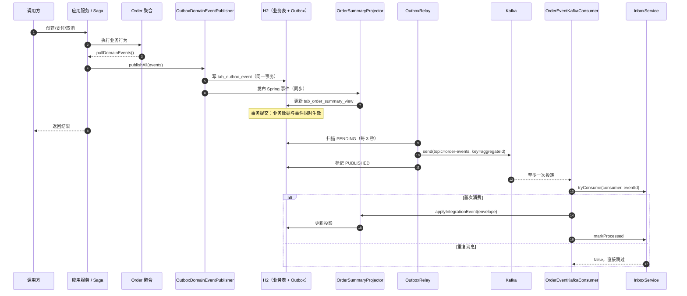
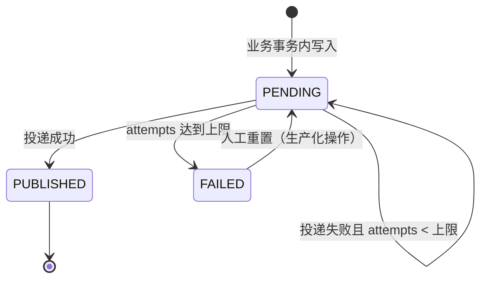
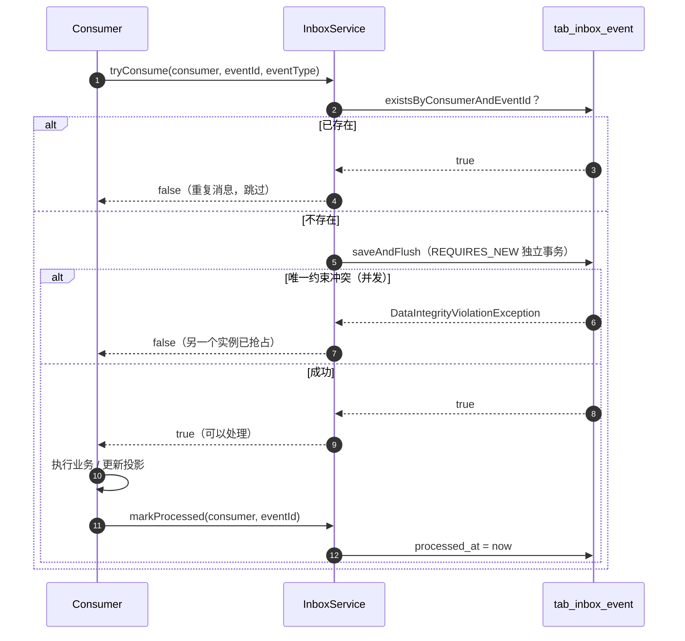

# 06 · 事件驱动 CQRS 与收件箱

本篇说明订单服务如何把“领域事件”变成“跨服务可消费的事实”，以及读写模型如何分离。核心链路是：

```text
聚合登记事件 → 应用层拉取 → Outbox 落库 → 本地同步投影（强一致）
                                   └→ 中继投递 Kafka → 消费端 Inbox 去重 → 投影（最终一致）
```

涉及代码：

| 组件 | 位置 |
| --- | --- |
| 领域事件契约 | `domain/event/DomainEvent.java` |
| 事件发布端口 | `domain/event/DomainEventPublisher.java` |
| Outbox 发布实现 | `infrastructure/messaging/outbox/OutboxDomainEventPublisher.java` |
| Outbox 实体/状态 | `infrastructure/messaging/outbox/OutboxEvent.java`、`OutboxStatus.java` |
| Outbox 中继 | `infrastructure/messaging/outbox/OutboxRelay.java` |
| Kafka 发送器 | `infrastructure/messaging/KafkaEventPublisher.java` |
| 集成事件契约 | `contracts/IntegrationEvent.java` |
| 读模型投影 | `infrastructure/readmodel/OrderSummaryProjection.java` |
| 投影器 | `infrastructure/readmodel/OrderSummaryProjector.java` |
| 收件箱 | `infrastructure/idempotency/inbox/` |
| Kafka 消费者 | `infrastructure/messaging/OrderEventKafkaConsumer.java` |
| 读模型接口 | `interfaces/web/OrderReadModelController.java` |

---

## 1. 为什么需要事件与 CQRS

订单写侧的职责是守住业务不变量：状态只能按状态机迁移、金额必须自洽、订单项只在 `CREATED` 可改。这类操作需要加载完整聚合、加乐观锁、在同一个事务里写多张表。

但展示需求与写模型并不一致：

- 列表页只需要订单号、客户、状态、应付金额，不需要订单项与支付明细。
- 报表、搜索、跨服务订阅需要按状态、客户、时间等维度灵活查询。
- 下游服务（风控、积分、通知）关心“发生了什么”，而不是订单表的当前快照。

如果所有查询都直接读写模型，就会遇到两个问题：

1. **查询被迫加载聚合**：列表页也要联表读取订单项，写模型被展示需求反向塑形。
2. **跨服务只能同步调用**：下游服务无法独立演进，订单服务也不该知道所有下游。

CQRS（命令查询职责分离）把读写拆开：

| 维度 | 写侧（Command） | 读侧（Query） |
| --- | --- | --- |
| 入口 | `OrderApplicationService`、Saga | `OrderQueryService`、`OrderReadModelQueryService` |
| 数据源 | `tab_order` 等写模型表 | `tab_order_summary_view` 投影表 |
| 事务 | 需要事务与乐观锁 | 只读事务 |
| 一致性 | 强一致 | 单进程强一致 / 跨进程最终一致 |
| 关注点 | 不变量、状态机、补偿 | 展示字段、查询性能 |

本项目保留两条查询路径，便于对比：

- `GET /api/orders`：读写模型聚合，强一致，能查到刚创建的数据。
- `GET /api/read-models/orders`：只读投影表，不触碰聚合，适合列表与报表。

---

## 2. 事件从聚合到跨服务的完整链路

### 2.1 聚合内登记，应用层统一发布

聚合根不直接发消息，只把“已经发生的事实”登记在内部列表里：

```java
// Order 聚合内（示意）
private final List<DomainEvent> domainEvents = new ArrayList<>();

private void registerEvent(DomainEvent event) {
    this.domainEvents.add(event);
}

public List<DomainEvent> pullDomainEvents() {
    List<DomainEvent> events = List.copyOf(domainEvents);
    domainEvents.clear();
    return events;
}
```

应用服务在业务事务内完成持久化后，统一交给发布端口：

```java
// OrderApplicationService / OrderCreationSaga 内（示意）
orderRepository.save(order);
domainEventPublisher.publishAll(order.pullDomainEvents());
```

这样做的原因：

- 聚合只依赖领域事件接口，不依赖 Kafka、Spring 事件等基础设施。
- 事件与订单在同一个事务里写入 Outbox，避免“订单成功、事件丢失”。
- 事件 ID 在聚合内生成一次，重试与重放期间保持不变，消费端才能可靠去重。

### 2.2 Outbox 发布：同事务落库 + 本地事件

`OutboxDomainEventPublisher.publishAll` 做两件事：

1. 把领域事件包装为 `IntegrationEvent` 信封，序列化后写入 `tab_outbox_event`；
2. 通过 Spring `ApplicationEventPublisher` 发布进程内事件，供本地监听器同步处理。

```java
IntegrationEvent envelope = IntegrationEvent.of(event, objectMapper.valueToTree(event));
String payload = objectMapper.writeValueAsString(envelope);
outboxRepository.save(OutboxEvent.create(event, payload));
localPublisher.publishEvent(event);
```

关键点：

- **同一事务**：业务数据、状态历史、Outbox 记录一起提交或一起回滚。
- **序列化失败即回滚**：`JsonProcessingException` 被转成 `IllegalStateException`，避免业务已提交但事件缺失。
- **本地事件同步执行**：`@EventListener` 默认同步，投影更新与业务事务同生共死，单进程内读模型强一致。

### 2.3 中继投递 Kafka

`OutboxRelay` 是定时任务：

```java
@Scheduled(fixedDelayString = "${app.outbox.relay-interval-ms:3000}")
@Transactional
public void relay() {
    List<OutboxEvent> pending =
            outboxRepository.findTop20ByStatusOrderByIdAsc(OutboxStatus.PENDING);
    // 逐条发送，失败只影响自身状态
}
```

| 行为 | 说明 |
| --- | --- |
| 扫描频率 | 默认 3 秒一轮，`app.outbox.relay-interval-ms` |
| 单轮批量 | 最多 20 条，按主键升序 |
| 成功 | `PENDING → PUBLISHED`，记录 `published_at` |
| 失败 | `attempts + 1`，保持 `PENDING` 等待下一轮 |
| 超过上限 | `attempts >= app.outbox.max-attempts`（默认 5）时置为 `FAILED`，停止自动重试 |
| 消息 key | 聚合标识（订单号或订单主键），保证同一聚合的事件落在同一分区 |
| Kafka 关闭 | `KafkaEventPublisher` 只记录日志并直接返回，中继仍标记 `PUBLISHED` |

注意：`KafkaEventPublisher` 在 `app.messaging.kafka-enabled=false` 时**不会抛异常**。这是刻意的降级设计：没有中间件也能完整演示订单流程，Outbox 依然记录事件，只是不真正进入 Kafka。生产环境应把“未启用”视为配置错误并告警。

### 2.4 全链路时序



---

## 3. 集成事件契约：IntegrationEvent

`contracts/IntegrationEvent` 是跨服务的“发布语言”，位于独立包，不依赖订单领域模型。

### 3.1 字段定义

```java
public record IntegrationEvent(
        String eventId,
        String eventType,
        int version,
        String aggregateType,
        String aggregateId,
        String occurredAt,
        JsonNode payload) {
}
```

| 字段 | 语义 | 消费端用途 |
| --- | --- | --- |
| `eventId` | 全局唯一事件 ID，来自 `DomainEvent#getEventId()` | 幂等去重、日志追踪 |
| `eventType` | 事件类型，默认取实现类简单类名 | 选择解析分支、路由 |
| `version` | 契约版本，默认 `1` | 兼容新旧版本事件 |
| `aggregateType` | 聚合类型，订单事件为 `Order` | 按聚合维度归类、重放 |
| `aggregateId` | 聚合标识，创建事件取订单号，状态事件取订单主键 | 分区键、聚合内有序 |
| `occurredAt` | 事件发生时间，ISO-8601 字符串 | 排序、延迟度量、乱序判断 |
| `payload` | 业务载荷，保持 JSON 树 | 按需转换，不要求消费端有领域类 |

### 3.2 为什么“信封 + 载荷”而不是直接发领域事件

领域事件是服务内部模型，字段可以随重构调整；一旦直接作为跨服务消息，任何字段改名都会破坏下游。信封把**稳定元数据**与**可演进载荷**分开：

- 元数据稳定：`eventId`、`eventType`、`version`、聚合标识、时间。
- 载荷可演进：新增字段对旧消费者透明；不兼容变更通过 `version` 递增，而不是修改历史事件。
- 消费端不需要反序列化为生产端的 Java 类，直接读 JSON 字段，避免领域模型耦合。

### 3.3 信封示例

订单创建事件（`OrderCreatedEvent`）投递后的报文形如：

```json
{
  "eventId": "9f1c2d3e-4a5b-6c7d-8e9f-0a1b2c3d4e5f",
  "eventType": "OrderCreatedEvent",
  "version": 1,
  "aggregateType": "Order",
  "aggregateId": "ORD-20261120-0001",
  "occurredAt": "2026-11-20T10:15:30.123Z",
  "payload": {
    "orderNum": "ORD-20261120-0001",
    "customerId": 1001,
    "payableAmount": {
      "amount": 190.00,
      "currency": "CNY"
    },
    "occurredAt": "2026-11-20T10:15:30.123Z",
    "id": "9f1c2d3e-4a5b-6c7d-8e9f-0a1b2c3d4e5f"
  }
}
```

状态变更事件（`OrderStatusChangedEvent`）的 `payload` 关键字段：

```json
{
  "orderId": 1,
  "orderNum": "ORD-20261120-0001",
  "from": "CREATED",
  "to": "PAID",
  "event": "PAY",
  "occurredAt": "2026-11-20T10:16:02.456Z",
  "id": "1a2b3c4d-5e6f-7a8b-9c0d-1e2f3a4b5c6d"
}
```

> 时间字段为 ISO-8601 字符串；具体毫秒与 `Z` 后缀由 Jackson 的日期配置决定，消费端应按字符串解析，不要假设固定格式。

### 3.4 版本演进规则

| 变更 | 是否兼容 | 做法 |
| --- | --- | --- |
| 新增可选字段 | 兼容 | 保持 `version` 不变，消费者忽略未知字段 |
| 新增必填字段 | 不兼容 | 递增 `version`，新旧事件并存一段时间 |
| 字段改名 | 不兼容 | 递增 `version`，消费端按版本分支解析 |
| 删除字段 | 不兼容 | 先让所有消费端停止依赖，再删除 |
| 语义变化（如状态枚举含义） | 不兼容 | 递增 `version` 并在文档中标注迁移窗口 |

当前示例中 `DomainEvent#version()` 默认返回 `1`，需要升版本时在具体事件类覆盖：

```java
@Override
public int version() {
    return 2;
}
```

---

## 4. Outbox 表与状态机

### 4.1 表结构

`tab_outbox_event`：

| 列 | 类型/约束 | 说明 |
| --- | --- | --- |
| `id` | 自增主键 | 排序与批量扫描 |
| `event_id` | 唯一约束 `uk_outbox_event_id` | 防止同一事件重复落库 |
| `aggregate_type` | 非空 | 聚合类型，如 `Order` |
| `aggregate_id` | 非空 | 聚合标识，投递时作为 Kafka key |
| `event_type` | 非空 | 事件类型 |
| `payload` | LOB，非空 | 完整的 `IntegrationEvent` JSON |
| `status` | 非空 | `PENDING / PUBLISHED / FAILED` |
| `attempts` | 非空，默认 0 | 已失败次数 |
| `last_error` | 长度 1000 | 最近一次失败原因，超长截断 |
| `created_at` | 非空 | 与业务同事务写入 |
| `published_at` | 可空 | 成功投递时间 |

索引 `idx_outbox_status_id(status, id)` 服务于中继按状态、主键顺序批量扫描。

### 4.2 状态迁移



要点：

- `FAILED` 是终态，不会自动重试；需要人工排查后把状态重置为 `PENDING`，或写入补偿任务。
- 中继单条失败不会回滚整轮事务，其他事件继续投递。
- 当前实现假设单实例运行；多实例部署时同一批记录可能被多个实例扫描，导致重复投递。消费端必须按 `eventId` 幂等，不能依赖“消息只来一次”。

### 4.3 为什么不用“先发 Kafka 再写库”

如果先发消息再写库：

- 消息发送成功、数据库回滚 → 下游看到不存在的订单。
- 数据库提交、消息发送失败 → 事件永久丢失。

Outbox 把“是否要发”变成数据库事实，发送动作可以重试，从而获得“至少一次”的投递保证。代价是延迟（默认最多 3 秒）和重复投递，两者分别由调度周期和消费端幂等处理。

---

## 5. 读模型设计

### 5.1 投影表

`tab_order_summary_view` 是面向列表展示的宽表：

| 列 | 说明 |
| --- | --- |
| `order_num` | 业务主键，与写侧订单号一一对应 |
| `order_id` | 订单主键，创建事件不携带，状态事件补全 |
| `customer_id` | 客户标识 |
| `status` | 订单当前状态，冗余自写模型 |
| `payable_amount` | 应付金额 |
| `currency` | 币种 |
| `created_at` | 投影首次创建时间 |
| `updated_at` | 投影最后更新时间 |
| `last_event_id` | 最后应用的事件 ID，用于识别重复 |
| `last_event_at` | 最后应用的事件时间，用于识别乱序 |
| `last_event_type` | 最后应用的事件类型，便于排查来源 |

索引：`idx_order_summary_status(status)`、`idx_order_summary_updated(updated_at)`。

为什么不直接查 `tab_order`：

- 列表页不需要订单项与支付记录，投影表避免联表。
- 投影字段可以按展示需要增加（如渠道、标签），不影响写模型。
- 读侧可以独立加缓存、换存储（如 Elasticsearch），写侧不需要感知。

### 5.2 两条更新通道

`OrderSummaryProjector` 同时支持：

1. **本地同步通道**：`@EventListener` 接收 `OrderCreatedEvent`、`OrderStatusChangedEvent`，在业务事务内更新投影。
2. **异步通道**：`applyIntegrationEvent(IntegrationEvent)` 由 Kafka 消费者调用，按 `eventType` 解析 JSON 载荷。

```java
@EventListener
@Transactional
public void onOrderCreated(OrderCreatedEvent event) {
    OrderSummaryProjection projection = projectionRepository
            .findById(event.orderNum())
            .orElseGet(() -> OrderSummaryProjection.blank(event.orderNum(), null));
    projection.applyCreated(
            event.customerId(),
            event.payableAmount().getAmount(),
            event.payableAmount().getCurrency(),
            event.id(),
            event.occurredAt());
    projectionRepository.save(projection);
}
```

两条通道的差异：

| 维度 | 本地同步 | Kafka 异步 |
| --- | --- | --- |
| 触发时机 | 业务事务内，事件发布后立即执行 | 中继投递后，由消费者触发 |
| 一致性 | 单进程内强一致 | 最终一致，存在秒级延迟 |
| 失败影响 | 随业务事务回滚 | 由 Kafka 重试/死信策略处理 |
| 典型用途 | 同进程读模型、缓存刷新 | 跨服务订阅、独立读服务 |

### 5.3 乱序与重复保护

投影内部用 `lastEventAt` 做时间戳水位：

```java
private boolean isStale(Instant occurredAt) {
    return occurredAt != null && lastEventAt != null && !occurredAt.isAfter(lastEventAt);
}
```

规则是“事件时间不晚于最后已应用事件时间即忽略”。这能覆盖：

- 重复投递：同一事件再次到达，时间相等 → 忽略。
- 乱序到达：旧事件晚到，时间更早 → 忽略。

局限：

- 同一时间戳的不同事件无法区分先后来，需要额外的序列号。
- 状态迁移并非严格线性（如退款失败回到原状态），仅靠时间水位不足以还原所有中间态；当前场景只关心最终状态，因此够用。
- 跨分区消费时时间戳水位不能替代按聚合分区有序；本项目用 `aggregateId` 作为 Kafka key，保证同一订单进入同一分区。

### 5.4 创建事件先到 / 状态事件先到的处理

`OrderSummaryProjection.blank(orderNum, orderId)` 会创建一条 `status = UNKNOWN` 的占位投影。这样无论哪个事件先到，都不会因为“找不到投影”而丢事件；后续事件会补全字段。

```text
状态事件先到：blank → applyStatus(PAID) → status=PAID
创建事件后到：applyCreated 因时间更早被 isStale 忽略
```

注意：这种处理保证“不丢”，但不保证“字段齐全”。如果业务要求创建事件必须补全金额，需要在投影上增加“待补全”标记，或由对账任务回查写模型。

### 5.5 查询接口

```bash
# 最近更新的读模型
curl "http://localhost:8080/api/read-models/orders"

# 按状态过滤
curl "http://localhost:8080/api/read-models/orders?status=PAID"

# 按订单号查询
curl "http://localhost:8080/api/read-models/orders/ORD-20261120-0001"
```

响应示例：

```json
[
  {
    "orderNum": "ORD-20261120-0001",
    "orderId": 1,
    "customerId": 1001,
    "status": "PAID",
    "payableAmount": 190.00,
    "currency": "CNY",
    "updatedAt": "2026-11-20T10:16:02.789",
    "lastEventType": "OrderStatusChangedEvent"
  }
]
```

限制：

- 最多返回 100 条，按 `updated_at` 倒序，不做分页。
- 未命中投影时返回 400（`IllegalArgumentException` 被全局异常处理器映射）。
- 投影未同步时可能查不到刚创建的订单；需要强一致读请走 `GET /api/orders`。

---

## 6. 收件箱（Inbox）去重

### 6.1 问题

Kafka 默认是“至少一次”投递，以下情况都会导致重复消息：

- 生产者重试（网络超时但消息实际已写入）。
- 消费者处理成功但提交位点前崩溃。
- Outbox 多实例扫描导致重复发送。

如果消费逻辑不是幂等的，重复消息会造成状态回退、计数翻倍、重复发券等问题。

### 6.2 表结构

`tab_inbox_event`：

| 列 | 说明 |
| --- | --- |
| `id` | 自增主键 |
| `consumer` | 消费者名称，隔离不同消费逻辑的去重空间 |
| `event_id` | 事件 ID，来自信封 |
| `event_type` | 事件类型，便于排查 |
| `received_at` | 接收时间 |
| `processed_at` | 处理完成时间；为空表示已抢占但尚未确认 |

唯一约束 `uk_inbox_consumer_event(consumer, event_id)` 是最终防线。

### 6.3 抢占流程



### 6.4 为什么用 REQUIRES_NEW

`tryConsume` 使用 `TransactionTemplate` 并设置 `PROPAGATION_REQUIRES_NEW`：

```java
TransactionTemplate template = new TransactionTemplate(transactionManager);
template.setPropagationBehavior(TransactionDefinition.PROPAGATION_REQUIRES_NEW);
```

原因：

- 如果收件箱写入与业务消费共用一个事务，唯一约束冲突会把整个事务标记为 `rollback-only`，调用方即使捕获异常也无法继续。
- 独立事务让“抢占记录”单独提交或回滚；冲突只影响抢占动作本身。
- 冲突异常在事务模板之外捕获，返回 `false`，语义清晰。

### 6.5 失败与半成品记录

`tryConsume` 成功但业务处理抛异常时，会留下一条 `processed_at` 为空的记录。下一次相同事件到达时：

- 当前实现看到记录已存在，直接返回 `false`，**不会重试业务处理**。

这在演示中可接受，但生产环境需要补齐：

| 生产化增强 | 说明 |
| --- | --- |
| 状态字段 | 增加 `PROCESSING / DONE / FAILED`，而不是用 `processed_at` 是否为空推断 |
| 失败重试 | 处理失败时把记录置为 `FAILED` 并允许重试，或删除记录让消息重新消费 |
| 超时回收 | 定期扫描长时间 `PROCESSING` 的记录，交给补偿任务 |
| 告警 | 对 `processed_at` 长期为空的记录报警 |

### 6.6 消费者实现

`OrderEventKafkaConsumer` 的流程：

```java
String eventId = text(message, "eventId");
String eventType = text(message, "eventType");
if (eventId == null || eventType == null) {
    log.warn("收到缺少信封元数据的消息，已忽略: {}", message);
    return;
}
if (!inboxService.tryConsume(CONSUMER, eventId, eventType)) {
    return;
}
IntegrationEvent envelope = new IntegrationEvent(...);
projector.applyIntegrationEvent(envelope);
inboxService.markProcessed(CONSUMER, eventId);
```

设计点：

- 消费者名固定为 `order-summary-projection`，与业务逻辑绑定；不同消费逻辑应使用不同名称。
- 旧格式消息（没有信封元数据）只记录日志并忽略，无法可靠去重时不做有风险的写入。
- 消费逻辑保持轻量，异常向上抛出，由 Spring Kafka 容器按重试与错误处理策略处置。
- 默认 `app.messaging.consumer-enabled=false`，不启动消费者；开启 Kafka 后需要同时打开该开关。

---

## 7. 一致性模型与取舍

| 场景 | 一致性 | 说明 |
| --- | --- | --- |
| 业务事务内写订单 + 状态历史 + Outbox | 强一致 | 同一数据库事务 |
| 本地同步投影 | 单进程强一致 | `@EventListener` 在业务事务内执行 |
| Outbox → Kafka | 最终一致 | 默认最多 3 秒延迟，失败重试 |
| Kafka → 消费端投影 | 最终一致 | 至少一次投递 + Inbox 去重 |
| 读模型查询 | 可能陈旧 | 跨进程场景下允许短暂滞后 |

常见误区：

1. **以为 Outbox 能保证“恰好一次”**：它保证“业务成功则事件一定落库”，投递仍是至少一次。
2. **在事件里放实体对象**：序列化结果依赖内部结构，重构即破坏契约；应只放值字段。
3. **消费端直接依赖生产端领域类**：消费端会被迫跟随生产端升级；应只依赖信封与 JSON 字段。
4. **用读模型做写前校验**：读模型可能滞后，唯一性、库存等校验必须走写侧或专用服务。
5. **忽略 Kafka 关闭时的降级**：本地演示能跑通，不代表事件真的发出去了；上线前必须检查开关。

---

## 8. 与 Saga、库存的边界

- **Saga 负责“流程是否走完”**：步骤、重试、补偿、超时，关注一次跨服务操作的执行状态。详见 [04-persistent-saga.md](./04-persistent-saga.md)。
- **Outbox/CQRS 负责“事实如何传播”**：事件落库、投递、投影、去重，关注状态变化的可见性。
- **库存预占负责“资源如何占用与归还”**：预占单、确认、释放、TTL，关注资源生命周期。详见 [05-inventory-reservation.md](./05-inventory-reservation.md)。

三者职责不重叠：

```text
创建订单：Saga 编排库存预占与订单落库
         └→ 订单落库时产生 OrderCreatedEvent
            └→ Outbox 落库 → 本地投影 → Kafka → 下游订阅
支付订单：确认库存预占 + 状态迁移
         └→ 产生 OrderStatusChangedEvent
            └→ 读模型状态更新为 PAID
```

不要把“补偿”做成事件消费：补偿需要明确的执行顺序与结果确认，应该由 Saga 编排器同步驱动；事件适合通知与投影，不适合承载“必须完成”的命令。

---

## 9. 生产化增强清单

| 方向 | 当前实现 | 建议 |
| --- | --- | --- |
| Outbox 多实例 | 单实例假设，可能重复投递 | 使用 `SELECT ... FOR UPDATE SKIP LOCKED` 或分布式锁 |
| Outbox 失败 | 标记 `FAILED` 后停止 | 告警、人工重置、死信归档 |
| Outbox 归档 | 无 | 定期清理 `PUBLISHED` 历史记录 |
| 消费重试 | 依赖 Spring Kafka 默认策略 | 配置退避重试与死信主题 |
| Inbox 半成品 | `processed_at` 为空即视为已消费 | 增加状态机、重试与超时回收 |
| 事件版本 | 单版本 | 消费端按 `version` 分支，保留兼容窗口 |
| 读模型重建 | 无 | 提供按事件回放重建投影的工具 |
| 可观测 | 日志 | 增加事件积压、投影延迟、失败率指标 |

---

## 10. 本篇小结

- 领域事件在聚合内登记，应用层在事务内交给 Outbox，基础设施负责异步投递。
- `IntegrationEvent` 把稳定元数据与可演进载荷分开，是跨服务的发布语言。
- Outbox 用数据库事务保证“业务成功则事件不丢”，代价是延迟与重复，重复由 Inbox 处理。
- 读模型按展示需求独立建模，本地同步投影保证单进程强一致，Kafka 通道提供跨服务最终一致。
- 投影用事件时间水位抵御重复与乱序，但复杂状态回放仍需序列号或位点管理。
- Saga、Outbox/CQRS、库存预占各自解决不同问题，不要互相替代。

下一篇：[07-architecture-and-testing.md](./07-architecture-and-testing.md) 说明如何用 ArchUnit 守住这些边界，以及测试如何分层。
